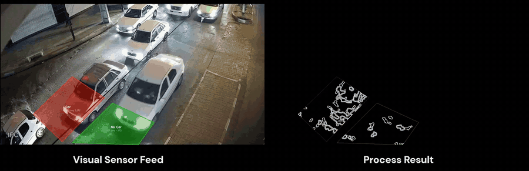

# Adaptive Intersection Controller — Camera-Based Vehicle Detection

Camera-based vehicle-presence detection — lane-level ROIs as virtual inductive loops — feeding an adaptive traffic-signal controller.

> This page is the project's showcase. The production source code is proprietary to Anamis Electronic Vira.

**Anamis Electronic Vira (GambroTech)** · Working Student – Computer Vision & Embedded Vision · 09/2020 — 09/2022

One camera per approach watches the lanes behind the stop line. Classical computer vision turns each lane into a virtual inductive loop and sends a 0/1 presence signal per lane over RS-485 to the intersection controller, which sizes each green from it. Piloted in 2021 at 3 intersections in Bandar Abbas with 12 cameras; my part was the detection module.

## Field results — 3 intersections, Bandar Abbas (2021)

Piloted at three intersections in Bandar Abbas, Iran — Damahi, University and Otobusrani — with 12 cameras. Results were measured at the evaluated junction over 123 days of logged adaptive operation and are a team result; my part was the detection module. The cycle lengthened automatically by up to 14% at the evening peak. Through a 10-day vision outage the junction ran on fixed time and returned to adaptive mode automatically. The Bandar Abbas traffic department formally commended the project and requested an extension to more intersections.

| Result | Value | Context |
|---|---|---|
| Shorter average cycle | **12%** | vs. the junction's fixed-time plan · 64.7 s → 56.9 s |
| More cycles per day | **14%** | same junction, same season |
| Main-road green share | **49% → 57%** | adaptive vs. fixed time |
| Lower main-road wait at red | **~28%** | 10.5 s → 7.6 s · random-arrival estimate |
| Adaptive-mode availability | **92.5%** | in heat up to 45 °C |
| Signal phases analysed | **371K** | recovered from a corrupted controller log |

## My role

- Implemented the camera-based vehicle-presence detection under the guidance of a senior engineer: Python and OpenCV with adaptive background subtraction, Canny edges and lane-level ROIs as virtual inductive loops, on Raspberry-Pi-class hardware without a GPU or neural network.
- Detection covered cars, motorcycles and bicycles. The module sent a 0/1 presence signal per lane over RS-485 to the intersection controller; the protocol stack was owned by another team.
- Monitored the pilot remotely via logs and camera streams.

## From field problem to fix

- Raw edge counting produced false positives on wet asphalt.
- Adaptive background subtraction effectively eliminated them.
- The remaining miss rate of ~6% came from vehicles stopping outside the ROI.

## Field data analysis

- Recovered and analysed 371,000 signal phases from a controller SD-card log corrupted by SPI noise (Python, pandas, MySQL).
- Used a 10-day vision outage as a fixed-time comparison, and identified a heat-related availability drop and a stuck-detector fault.

## Tech stack

Python · OpenCV · Adaptive background subtraction · Canny edge detection · Lane-level ROIs · Raspberry-Pi-class hardware · RS-485 · pandas · MySQL

## License

[MIT](LICENSE) — applies to the documentation in this repository.
